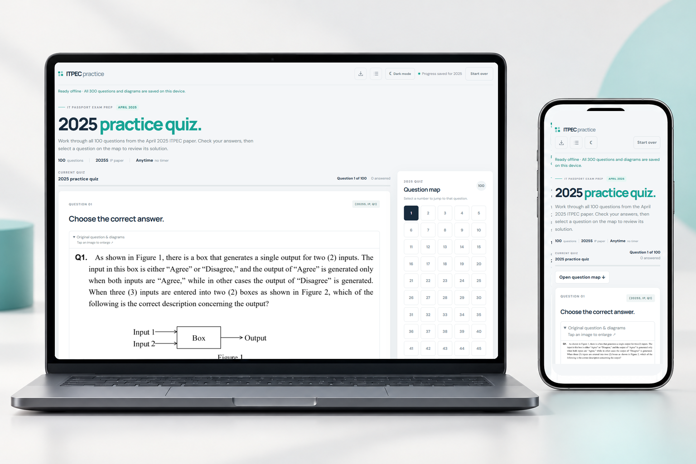

# IPreview

ITPEC IT Passport practice quizzes with 100 questions each for April 2025, 2024
and 2023. The root home page opens the 2025 quiz.

## Portfolio preview

## PDF study materials

Click a link below to open the PDF on GitHub.

- [ITPEC IP 2024–2025 reviewer](doc/reviewer/pdf/ITPEC_IP_2024_2025_Reviewer.pdf)

### Exam papers and answer keys

| Exam session | Questions                                                | Answers                                            |
| ------------ | -------------------------------------------------------- | -------------------------------------------------- |
| 2025 Spring  | [Question paper](doc/exam-papers/2025S_IP_Questions.pdf) | [Answer key](doc/answer-keys/2025S_IP_Answers.pdf) |
| 2024 Autumn  | [Question paper](doc/exam-papers/2024A_IP_Questions.pdf) | —                                                  |
| 2024 Spring  | [Question paper](doc/exam-papers/2024S_IP_Questions.pdf) | [Answer key](doc/answer-keys/2024S_IP_Answer.pdf)  |
| 2023 Autumn  | [Question paper](doc/exam-papers/2023A_IP_Questions.pdf) | —                                                  |
| 2023 Spring  | [Question paper](doc/exam-papers/2023S_IP_Questions.pdf) | [Answer key](doc/answer-keys/2023S_IP_Answer.pdf)  |

Additional reference: [2026 Spring answers PDF](doc/exam-papers/2026S_IP_Answers.pdf).

## Develop

- Open index.html for a local preview, or serve the project with a static server.
- Edit pages in html/, styles in css/, and browser behavior in js/.
- Shared page markup is generated from tools/templates/quiz-page.html.
- Browser question banks are in data/quizzes/; editable source content is in data/source/.
- Documentation and reference PDFs belong in doc/. It contains no application code.

Run npm install once to install the development formatter and test library.

| Command              | Purpose                                                |
| -------------------- | ------------------------------------------------------ |
| npm run build        | Build the deployable website into dist/                |
| npm test             | Build and verify quiz behavior and deployment contents |
| npm run format       | Format the application, tools and documentation        |
| npm run format:check | Check formatting                                       |
| npm run package      | Create artifacts/ipreview-tiiny-host.zip               |

After changing question source data or shared page markup, run
python tools/compile_quizzes.py and npm run format.

## Deploy on Vercel

Import this repository and keep its Root Directory at the repository root.
The included vercel.json sets the build command and publishes only dist/.
The production build uses Node's built-in libraries and needs no package installation.

For Tiiny.host, upload artifacts/ipreview-tiiny-host.zip after npm run package.

## Quiz behavior

Progress is saved separately for each year in the visitor's browser.
The question map links to inline explanations after grading. Correct answers
are included in the browser data because this is a self-study reviewer.
Question citations link the material to ITPEC's past papers; study explanations
are added reviewer content.

## Install and study offline

Open the deployed HTTPS website, then select the download icon in the navbar.
Use **Install app** when offered. On iPhone or iPad, open the site in Safari and
choose **Share → Add to Home Screen**.

Stay online until the status reads **Ready offline**. All three quizzes, all 300
questions, explanations and diagrams are then saved on that device, including
years you have not opened yet. You can close the app, disconnect and reopen it
to study, grade answers and keep your progress. External reference websites and
PDF links on GitHub still need internet. Fonts fall back to device fonts offline.

Clearing browser/site data removes downloaded quizzes and saved progress.
New releases download when online and become active after all old app tabs close.

To test the PWA locally, run `npm run build`, then
`python -m http.server 8000 --directory dist` and open `http://localhost:8000`.
Opening HTML through `file://` supports the quiz but cannot install a service worker.

See [project architecture](doc/architecture.md) for module responsibilities,
naming conventions and the deployment boundary.
